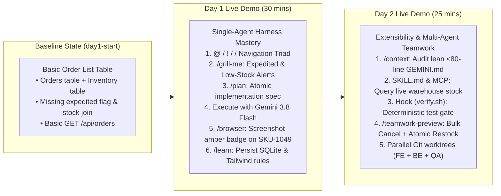

# `order-pulse`: 3-Tier Demo App Implementation Plan & Live Runbook

**Application Name:** `order-pulse` (Retail Order Triage & Inventory Restock Dashboard)
**Tech Stack:**
- **Frontend:** React 18 + Vite + Tailwind CSS + TypeScript (`client/`)
- **Backend:** Node.js + Express + TypeScript (`server/`)
- **Database:** SQLite via `better-sqlite3` (`server/data/orders.sqlite`)
- **Testing:** Vitest + Supertest (`server/tests/`)

---

## 1. Narrative Arc Across Day 1 & Day 2



---

## 2. Repository Structure & Scaffolding Plan

```text
order-pulse/
├── package.json                        # Root workspace runner (concurrently runs client + server)
├── GEMINI.md                           # Lean (<80 lines) project constitution
├── PRD.md                              # Durable product spec ("The Elephant" for Day 2)
├── .agents/
│   ├── rules/                          # Empty on Day 1 start -> populated live via /learn
│   ├── skills/
│   │   └── inventory-audit/
│   │       └── SKILL.md                # Progressive-disclosure skill showcased on Day 2
│   ├── agents/
│   │   └── test-auditor.md             # Custom QA subagent showcased on Day 2
│   └── hooks/
│       └── verify.sh                   # Deterministic verification ratchet (npm test + tsc)
├── server/
│   ├── package.json
│   ├── tsconfig.json
│   ├── src/
│   │   ├── index.ts                    # Express app entry point (Port 3001)
│   │   ├── db.ts                       # SQLite initialization & retail seed data
│   │   └── routes/
│   │       └── orders.ts               # REST endpoints (/api/orders)
│   └── tests/
│       └── orders.test.ts              # Vitest + Supertest API test suite
└── client/
    ├── package.json
    ├── vite.config.ts                  # Vite config with /api proxy -> localhost:3001
    ├── tailwind.config.js
    ├── index.html
    └── src/
        ├── main.tsx
        ├── App.tsx                     # Dashboard header & KPI summary cards
        └── components/
            └── OrderTable.tsx          # Order table component
```

---

## 3. One-Shot Bootstrap Prompt (Build the Repo in 90 Seconds)

To build this entire demo repository locally before the workshop, open a terminal, create the folder, launch `agy`, and paste the prompt below:

```bash
mkdir -p ~/demos/order-pulse && cd ~/demos/order-pulse
git init
agy
```

> [!TIP]
> **Copy-Paste This Bootstrap Prompt into `agy`:**
> ```text
> Build a clean, self-contained 3-tier retail web application called "OrderPulse" in this directory with the following structure and exact baseline state:
>
> 1. ROOT (`package.json`):
>    - Scripts:
>      - `"dev"`: runs both backend (`server`) and frontend (`client`) concurrently.
>      - `"test"`: runs `npm --prefix server test` and `npm --prefix client run build`.
>
> 2. BACKEND (`server/`):
>    - TypeScript + Express (port 3001) + `better-sqlite3` + `cors`.
>    - `server/src/db.ts`: Initializes an SQLite database (supports `:memory:` when `NODE_ENV=test`, otherwise `server/data/orders.sqlite`).
>      - Enables `PRAGMA foreign_keys = ON;`.
>      - Creates two tables:
>        a) `inventory (sku TEXT PRIMARY KEY, product_name TEXT NOT NULL, stock_count INTEGER NOT NULL)`
>        b) `orders (id TEXT PRIMARY KEY, customer_name TEXT NOT NULL, sku TEXT NOT NULL, quantity INTEGER NOT NULL, status TEXT NOT NULL, created_at TEXT NOT NULL, FOREIGN KEY (sku) REFERENCES inventory(sku))`
>      - Seeds 5 realistic retail inventory items (ensure `SKU-1049` "Cashmere Crewneck Sweater" has `stock_count = 4`, `SKU-2088` "Selvedge Denim Jacket" has `stock_count = 42`, `SKU-3012` "Leather Chelsea Boots" has `stock_count = 7`, `SKU-4055` "Linen Blazer" has `stock_count = 85`, `SKU-5099` "Silk Evening Scarf" has `stock_count = 2`).
>      - Seeds 6 realistic retail orders (`ORD-1001` through `ORD-1006`) referencing those SKUs with statuses `'PENDING'`, `'PROCESSING'`, and `'SHIPPED'`.
>    - `server/src/routes/orders.ts`:
>      - `GET /api/orders`: Returns all orders joined with `inventory.product_name` (NOTE: intentionally do NOT expose `stock_count` or expedited shipping yet—we will add those live in our Day 1 workshop demo).
>      - `PATCH /api/orders/:id/status`: Updates an order's status.
>    - `server/tests/orders.test.ts`: Vitest + Supertest suite testing `GET /api/orders` and `PATCH /api/orders/:id/status`.
>
> 3. FRONTEND (`client/`):
>    - React 18 + Vite (port 5173, proxying `/api` to `http://localhost:3001`) + Tailwind CSS + TypeScript.
>    - Clean, modern enterprise retail UI ("OrderPulse — Fulfillment & Triage Portal").
>    - `client/src/App.tsx`: Header bar, 3 summary KPI cards (Total Orders, Pending Fulfillment, Shipped), and `<OrderTable />`.
>    - `client/src/components/OrderTable.tsx`: Displays Order ID, Customer, Product (`sku` + `product_name`), Quantity, Status pill, and a status dropdown.
>
> 4. AGENT HARNESS FILES:
>    - `GEMINI.md` (under 50 lines): Project overview, directory map, and verification command (`npm test`).
>    - `PRD.md`: Product requirements document for OrderPulse including Phase 1 (Expedited Triage & Low-Stock Alerts) and Phase 2 (Bulk Order Cancellation with Atomic Inventory Restock).
>    - `.agents/skills/inventory-audit/SKILL.md`: A skill with YAML frontmatter (`name: inventory-audit`, `description: Audits SQLite inventory stock levels and order allocation consistency`) that provides SQL inspection commands.
>    - `.agents/hooks/verify.sh`: Executable bash script running `npm test`.
>
> Install all dependencies, run `npm test` to verify everything passes, and create a git commit tagged `day1-start`.
> ```

---

## 4. Reference File Blueprints (Key Files)

If you want to inspect or tweak the files manually, here are the exact blueprints for the agent harness files included in the repo:

### A. `GEMINI.md` (Lean `<80` Line Constitution)
```markdown
# OrderPulse — Agent Constitution

## Stack & Architecture
- **Frontend (`client/`):** React 18, Vite, Tailwind CSS, TypeScript.Port: `5173`.
- **Backend (`server/`):** Node.js, Express, TypeScript, `better-sqlite3`. Port: `3001`.
- **Database (`server/src/db.ts`):** SQLite (`server/data/orders.sqlite`, or `:memory:` in test).

## Core Commands
- **Install:** `npm install`
- **Dev Server:** `npm run dev`
- **Verify All (Tests + Typecheck):** `npm test`

## Engineering Guardrails
1. Always run `npm test` after modifying backend routes or frontend components.
2. Never modify SQLite schemas without updating seed/migration logic in `server/src/db.ts`.
3. Use parameterized queries in `better-sqlite3` (`db.prepare(...)`). Never interpolate raw SQL strings.
4. Keep UI components in `client/src/components/` strictly typed with TypeScript interfaces.
```

### B. `.agents/skills/inventory-audit/SKILL.md` (Day 2 Skill Demo)
```markdown
---
name: inventory-audit
description: Audits SQLite inventory stock levels, low-stock SKUs, and order allocation anomalies. Use when asked to inspect warehouse stock, check restock thresholds, or validate inventory counts.
---

# Inventory Audit Skill

When asked to audit inventory or check warehouse stock health:

1. Query current stock vs. pending order allocations using `sqlite3`:
   ```bash
   sqlite3 -header -column server/data/orders.sqlite "
     SELECT i.sku, i.product_name, i.stock_count,
            COALESCE(SUM(CASE WHEN o.status != 'CANCELLED' THEN o.quantity ELSE 0 END), 0) AS allocated_qty
     FROM inventory i
     LEFT JOIN orders o ON i.sku = o.sku
     GROUP BY i.sku;
   "
   ```
2. Flag any SKU where `stock_count < 10` as `CRITICAL_LOW_STOCK`.
3. Present findings in a Markdown table sorted by `stock_count ASC`.
```

### C. `.agents/hooks/verify.sh` (Day 2 Deterministic Ratchet)
```bash
#!/usr/bin/env bash
set -euo pipefail

echo "🔒 [Hook: verify.sh] Running deterministic test & typecheck gate..."
npm --prefix server test -- --run
npm --prefix client run build
echo "✅ [Hook: verify.sh] All checks passed!"
```

---

## 5. Day 1 Live Demo Runbook (30 Minutes — Michael Solo)

**Session Context:** Day 1 (`00:45 – 01:15`) — *Driving the Harness & Intentful Prompting*
**Goal:** Take the audience from basic terminal navigation (`@`, `!`, `/`) to Socratic planning (`/grill-me`, `/plan`), fast execution with Gemini 3.8 Flash, visual UI testing (`/browser`), and continuous rule learning (`/learn`).

### Pre-Demo Prep (5 Mins Before Call)
```bash
cd ~/demos/order-pulse
git checkout day1-start
git clean -fd
rm -f .agents/rules/orders.md
npm test
```
*Ensure `npm run dev` is NOT running yet (or let the agent start it during Step 5).*

---

### Step 1: Terminal Grounding & The Navigation Triad (4 mins)

1. Launch Antigravity CLI in the terminal:
   ```bash
   agy
   ```
2. **Demonstrate `!` (Direct Shell Mode):**
   - Type:
     ```text
     ! npm test
     ```
   - Type:
     ```text
     ! sqlite3 -header -column server/data/orders.sqlite "SELECT * FROM orders;"
     ```
   - **Talk Track:** *"Notice I don't have to leave my agent harness or burn LLM tokens just to run a quick shell command or check my SQLite table. `!` executes directly in my local shell and keeps the output grounded in context."*
3. **Demonstrate `@` (Context Grounding):**
   - Type `@` and slowly type `orders` to show fuzzy autocomplete matching `server/src/routes/orders.ts` and `client/src/components/OrderTable.tsx`.
   - Run a quick grounding prompt:
     ```text
     Explain how @server/src/routes/orders.ts fetches orders and what fields @client/src/components/OrderTable.tsx currently renders.
     ```
4. **Demonstrate `/` (Slash Command Palette):**
   - Type `/` and scroll briefly through `/grill-me`, `/plan`, `/browser`, `/fork`, `/learn`, `/context`.

---

### Step 2: Socratic Intent Locking with `/grill-me` (7 mins)

1. **Talk Track:** *"The #1 mistake developers make with AI is typing a vague one-sentence prompt and letting the model guess the schema, API contract, and UI styling. Watch what happens when we use `/grill-me` instead."*
2. **Copy-Paste Prompt:**
   ```text
   /grill-me Add an expedited shipping flag and low-stock inventory alerts to the OrderPulse triage dashboard
   ```
3. **What the Agent Will Ask (and Your Quick Answers):**
   - *Agent Question 1 (Schema/Threshold):* How is low stock defined, and how should expedited shipping be stored in SQLite?
   - *Your Reply:*
     ```text
     1. Add `is_expedited INTEGER DEFAULT 0` to the `orders` table in `db.ts` (mark ORD-1001 and ORD-1003 as expedited in seed data).
     2. Join `inventory.stock_count` in `GET /api/orders` and flag any item with `stock_count < 10` as low stock.
     3. In React (`OrderTable.tsx`), add an "Expedited Only" filter toggle at the top, render a red "⚡ EXPEDITED" badge on expedited orders, and render an amber "⚠️ Low Stock ({stock_count} left)" badge when `stock_count < 10`.
     ```

---

### Step 3: Structured Planning with `/plan` (4 mins)

1. **Copy-Paste Prompt:**
   ```text
   /plan Implement the expedited shipping flag, inventory stock join, React filter toggle, and Tailwind badges based on our decisions.
   ```
2. **What to Highlight on Screen:**
   - Point out the structured `Implementation Plan` artifact.
   - Show how the plan breaks down cleanly across the 3 tiers:
     1. Database schema & seed update (`server/src/db.ts`)
     2. Express route & SQL JOIN update (`server/src/routes/orders.ts`)
     3. Vitest API test update (`server/tests/orders.test.ts`)
     4. React UI badges & filter toggle (`client/src/components/OrderTable.tsx`)

---

### Step 4: Execution with Gemini 3.8 Flash (5 mins)

1. Confirm the model selector is on **Gemini 3.8 Flash** (tie back to Dave's Slide 17 on Tokenomics: *"Frontier model for planning, Flash workhorse for fast execution"*).
2. Click **Proceed** / tell the agent to execute the plan.
3. Watch the agent edit the 4 files and automatically run `npm test` in the terminal to prove the backend unit tests pass.

---

### Step 5: Visual UI Verification with `/browser` (6 mins)

1. **Talk Track:** *"Passing unit tests is great, but how does the agent know our Tailwind CSS badges actually render properly and the filter toggle works in the DOM? Let's use `/browser`."*
2. **Copy-Paste Prompt 1 (Start Dev Server):**
   ```text
   Start the dev server in the background and confirm both ports 3001 and 5173 are listening.
   ```
3. **Copy-Paste Prompt 2 (Browser Verification):**
   ```text
   /browser Open http://localhost:5173, capture a full screenshot of the OrderPulse dashboard, click the "Expedited Only" filter toggle, verify that ORD-1001 shows both the "EXPEDITED" badge and the amber "Low Stock (4 left)" badge for SKU-1049, and capture a second screenshot.
   ```
4. **What to Highlight on Screen:**
   - Open the generated screenshot artifacts directly inside the UI.
   - Point out that the agent visually verified its own frontend work without you manually clicking around in Chrome.

---

### Step 6: Safe Experimentation (`/fork`) & Continuous Memory (`/learn`) (4 mins)

1. **Demonstrate `/fork`:**
   - Type `/fork` to show how you can branch the current conversation state if you wanted to test a risky database migration without polluting your main thread.
2. **Demonstrate `/learn`:**
   - **Talk Track:** *"During our session today, we established specific conventions for SQLite foreign keys, stock thresholds (`< 10`), and Tailwind badge colors. How do we make sure the next developer—or tomorrow's agent session—automatically follows these rules?"*
   - Type:
     ```text
     /learn Save our project conventions for SQLite schema updates, inventory stock thresholds, and Tailwind badge styling into .agents/rules/orders.md
     ```
   - Show the newly created `.agents/rules/orders.md` file ready to be committed to Git!
3. *(After Day 1 ends, commit this state as tag `day2-start`)*:
   ```bash
   git add -A && git commit -m "feat: day 1 expedited and low-stock triage" && git tag day2-start
   ```

---

## 6. Day 2 Live Demo Runbook (25 Minutes — Michael Solo)

**Session Context:** Day 2 (`00:50 – 01:15`) — *Extensibility, Hooks & Multi-Agent `/teamwork`*
**Goal:** Show how to audit context (`/context`), invoke dormant Skills (`SKILL.md`), enforce deterministic verification hooks (`verify.sh`), and run a multi-agent swarm (`/teamwork-preview`) across parallel Git worktrees.

### Pre-Demo Prep (5 Mins Before Call)
```bash
cd ~/demos/order-pulse
git checkout day2-start
chmod +x .agents/hooks/verify.sh
npm test
```

---

### Step 1: Context Auditing & Progressive Disclosure Skills (6 mins)

1. Launch `agy` inside `~/demos/order-pulse`.
2. **Run `/context`:**
   ```text
   /context
   ```
   - **Talk Track:** *"Look at our token breakdown. Because our `GEMINI.md` is under 50 lines and our `inventory-audit` Skill uses progressive disclosure, we are starting at near-zero context overhead—well out of the 150k+ token 'Dumb Zone'."*
3. **Trigger the Dormant Skill (`inventory-audit`):**
   - **Copy-Paste Prompt:**
     ```text
     Audit our current warehouse inventory stock levels and allocated order quantities. Which SKUs are critically low?
     ```
   - **What to Highlight:** Point out that Antigravity automatically detects the intent, loads `.agents/skills/inventory-audit/SKILL.md` on-demand, runs the exact SQLite aggregation query, and outputs the sorted Markdown table showing `SKU-5099` (2 left) and `SKU-1049` (4 left).

---

### Step 2: Deterministic Hooks — "Skill Authors, Hook Enforces" (4 mins)

1. Show `.agents/hooks/verify.sh` on screen:
   ```text
   ! cat .agents/hooks/verify.sh
   ```
2. **Talk Track:** *"In Slide 19 and 23 of the AI Factory Blueprint, we talked about 'The Ratchet'. An LLM will occasionally claim tests pass when it hasn't run them. By binding `verify.sh` as a completion hook, the harness physically runs `vitest` and `tsc` outside the model's control. If exit code != 0, the agent is forced back into the loop."*

---

### Step 3: Multi-Agent Orchestration with `/teamwork-preview` (15 mins)

1. **Frame the Multi-Tier Problem:**
   - **Talk Track:** *"Now let's tackle a realistic cross-stack feature from `PRD.md`: **Bulk Order Cancellation with Atomic Inventory Restock & Audit Logging**. This touches all three tiers simultaneously:*
     1. *SQLite (`db.ts`): Needs an `audit_logs` table and an atomic `db.transaction()` that marks multiple orders `CANCELLED`, adds their `quantity` back to `inventory.stock_count`, and writes audit records.*
     2. *Express (`orders.ts` + `orders.test.ts`): Needs `POST /api/orders/bulk-cancel` with rollback tests if an invalid order ID is passed.*
     3. *React (`OrderTable.tsx`): Needs multi-row selection checkboxes, a 'Select All' header, and a 'Cancel Selected ({count})' action bar.*
   - *Instead of one agent doing this sequentially and filling up its context window, let's spawn a team."*

2. **Copy-Paste Teamwork Prompt:**
   ```text
   /teamwork-preview Implement the Phase 2 Bulk Order Cancellation & Atomic Inventory Restock feature across the full stack:
   1. Backend & DB Worker: Add an `audit_logs (id INTEGER PRIMARY KEY AUTOINCREMENT, order_id TEXT, action TEXT, timestamp TEXT)` table in `server/src/db.ts`. Implement `POST /api/orders/bulk-cancel` accepting `{ orderIds: string[], reason: string }` in `server/src/routes/orders.ts` using an atomic `better-sqlite3` transaction that sets order status to `'CANCELLED'`, increments `inventory.stock_count` by each order's `quantity`, and inserts an audit log row. If any order ID is invalid or already cancelled, roll back the entire transaction and return 400.
   2. Frontend Worker: Update `client/src/components/OrderTable.tsx` to add row checkboxes for non-cancelled orders, a "Cancel Selected" toolbar button, and live refresh of order statuses and restocked inventory counts.
   3. QA Auditor Worker: Add comprehensive integration tests in `server/tests/orders.test.ts` verifying both successful batch cancellation (confirming `stock_count` increases and `audit_logs` are written) and atomic rollback when one order ID in the batch is invalid.
   ```

3. **What to Walk the Audience Through While the Swarm Runs:**
   - **The Agent Roster:** Point out the Coordinator/Architect spawning `backend-worker`, `frontend-worker`, and `qa-auditor`.
   - **Isolated Worktrees (`workspace: "share"` / `"branch"`):** Explain how `backend-worker` is editing `server/` in its own worktree while `frontend-worker` edits `client/` in parallel—zero file lock collisions!
   - **Shared Message Board:** Show the agents posting concise contract updates on the board (e.g., confirming the exact JSON payload `{ orderIds, reason }` and response structure) rather than dumping raw code into a shared chat.
   - **The Verification Gate:** Show `qa-auditor` running the new Supertest suite confirming that cancelling `ORD-1001` atomically restores `SKU-1049`'s stock count from `4` back to `6` and clears the Low Stock warning!

4. **Grand Finale Visual Check (Optional 1 min):**
   - Refresh `http://localhost:5173` in the browser, check two orders (`ORD-1001` and `ORD-1002`), click **Cancel Selected**, and watch the statuses flip to `CANCELLED` while `SKU-1049`'s stock count increments in real time!

---

## 7. Quick Emergency Recovery Cheat Sheet

| If This Happens During Live Demo... | Instant Recovery Command |
| :--- | :--- |
| Port `3001` or `5173` is already in use from an earlier test | `! lsof -ti:3001,5173 \| xargs kill -9` |
| SQLite database gets into a weird state mid-demo | `! rm -f server/data/orders.sqlite && npm run dev` *(auto-reseeds on boot!)* |
| Want to jump straight to the start of Day 1 Demo | `git checkout -f day1-start && git clean -fd` |
| Want to jump straight to the start of Day 2 Demo | `git checkout -f day2-start && git clean -fd` |
| Live Wi-Fi / API hiccup during `/teamwork-preview` | Pre-create a `day2-complete` git tag before the workshop so you can run `git diff day2-start..day2-complete` to show the exact multi-tier output |
